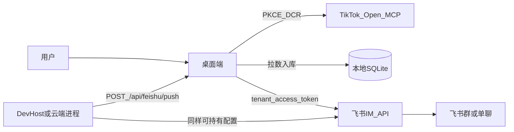

# 飞书应用机器人推送（TikTok Open MCP）

方案选型：**A（广告 MCP 数据）+ C（桌面鉴权 TikTok + 飞书应用身份推送）**。

## 官方能力对照

| 能力 | 文档结论 | 本项目用法 |
|------|----------|------------|
| 机器人类型 | 用**应用机器人**，不用群自定义 Webhook（无单聊/交互） | 企业自建应用 + 开启机器人 |
| 发消息身份 | `tenant_access_token`（应用身份） | `POST /auth/v3/tenant_access_token/internal` |
| 发送接口 | `POST /open-apis/im/v1/messages` | `msg_type=interactive` 卡片，失败回退 `text` |
| 权限 | `im:message:send_as_bot`（或 `im:message`） | 开发者后台申请并发布/测试企业生效 |
| 接收方 | 用户需在可用范围；群需拉入机器人 | 配置 `chat_id` / `open_id` 等 |

参考：

- [机器人概述](https://open.feishu.cn/document/uAjLw4CM/ukTMukTMukTM/bot-v3/bot-overview)
- [获取 tenant_access_token](https://open.feishu.cn/document/server-docs/authentication-management/access-token/tenant-access-token-internal)
- [发送消息](https://open.feishu.cn/document/server-docs/im/message/create-message)

## 身份拆分（混合模型）

- **TikTok 鉴权**：仍在桌面（Open MCP OAuth），token 本地加密存储。  
- **飞书推送**：应用身份，不依赖飞书用户 OAuth；只需 App ID / App Secret + 接收方 ID。  
- **云端触发**：`POST http://127.0.0.1:{port}/api/feishu/push`（DevHost / 本机 LocalApi）。完整 7×24 云推送需把同一套配置与数据进程部署到常驻主机（后续可拆独立 Worker）。

## 配置步骤

1. 飞书开发者后台创建企业自建应用 → 添加「机器人」能力。  
2. 权限：`im:message:send_as_bot`。测试企业可免审；正式环境需发布。  
3. 将机器人拉进目标群，或把用户加入应用可用范围。  
4. 桌面 **设置** 填写 App ID / App Secret / 接收方类型与 ID，勾选启用与「同步后自动推送」。  
5. **同步**页可点「推送到飞书」试发；或调用 LocalApi。

## 推送内容

基于看板 `overview` KPI（消耗 / 展示 / 点击 / 转化）+ 系列消耗 Top，组装飞书卡片。数据来自本地已同步的 MCP 结果（`report_integrated_get` 等）。
